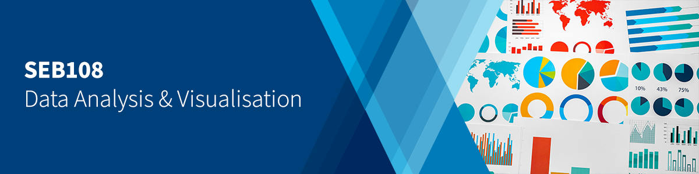

# SEB108 Foundations of Data Analysis and Visualisation

Teaching materials for SEB108 at QUT (Faculty of Science). Students learn Python for data analysis, then analyse real river water quality data for our industry partner, the Queensland Government's Water Quality & Investigations team (WQI).

Students reach these materials through the unit's Canvas site. This repository is where they're built and published.

## What's in this repository

| Folder | Contents |
|---|---|
| `practicals/` | Four weekly practicals, built as a website with [Quarto](https://quarto.org) and [quarto-live](https://r-wasm.github.io/quarto-live/). Python runs in the browser, so students don't install anything |
| `practicals/data/` | Practical data, Logan River at Yarrahappini |
| `assessment/` | The Assessment 1 workbook, a Google Colab notebook |
| `data/assessment/` | Assessment data for five Brisbane catchment sites, plus annual loads |

The practicals and the assessment use data from different rivers. Each practical teaches a step of the analysis on the practical data, and students then apply the same step to their own site in the workbook.

## Data credits

Water quality data © State of Queensland (Department of the Environment, Tourism, Science and Innovation), from the Tahbil Water Quality Data Portal run by Water Quality & Investigations, licensed under [CC BY 4.0](https://creativecommons.org/licenses/by/4.0/). The files in this repository are a modified subset of that data, selected and changed for teaching. They're used with the support of Water Quality & Investigations.

The methods behind the data are described in Water Quality & Investigations (2024), *Tahbil Water Quality Data Portal. Analyses, Quality and Methods for Calculating Pollutant Loads/Yields and the Pesticides Risk Metric*, Department of Environment, Science and Innovation, Brisbane, Australia.

## Licence

© 2026 Queensland University of Technology. Created by Dr Michael Cowley, Faculty of Science.

- The teaching materials, meaning the text of the practical pages and the workbook and our own figures, are licensed under the [Creative Commons Attribution 4.0 International licence (CC BY 4.0)](https://creativecommons.org/licenses/by/4.0/). See [LICENSE](LICENSE).
- The code, meaning the code in the practical pages and the workbook, the site's theme files and the publishing workflow, is licensed under the [MIT License](LICENSE-CODE).
- These licences don't cover the QUT logo, the SEB108 banners, the Colab screenshots or the water quality data, which stay under their owners' terms.

You're welcome to reuse and adapt these materials. Please credit them as *SEB108 Foundations of Data Analysis and Visualisation by Michael Cowley, © Queensland University of Technology, CC BY 4.0, github.com/mjcowley/SEB108*.

## Building the practicals

The practicals site is rebuilt and published automatically whenever changes are pushed to `main` (see `.github/workflows/publish-practicals.yml`).

To preview it locally, install [Quarto](https://quarto.org/docs/get-started/), then run this from the repository folder.

```bash
quarto preview practicals
```

The pages have to be served over the web to run their Python, so opening the HTML files directly won't work.
