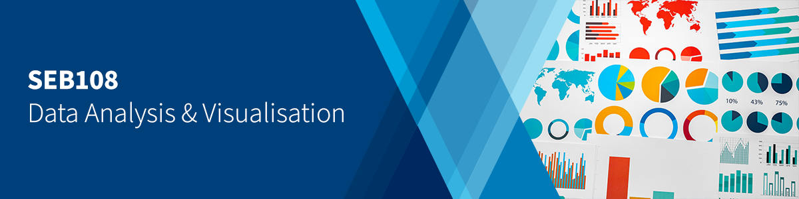

{fig-alt="SEB108 Data Analysis and Visualisation banner, with charts and maps on a blue background"}

These pages are where you learn the Python you'll use in SEB108. The code runs right here in your browser, so there's nothing to install, nothing to save and nothing to submit.

Your **assessment workbook** is separate. It's a Colab notebook you open from Canvas, and it's the only thing you hand in. Each practical ends with code you copy into your workbook, and a check-off.

| Week | Practical | What you'll learn | Check-off |
|---|---|---|---|
| 8 | [P1 Python basics](p1.qmd) | Running Python, loading a table of data, and picking out the rows you want | 1. Load and hypothesis |
| 9 | [P2 Cleaning data](p2.qmd) | Finding and fixing problems in real data, and splitting it into wet and dry seasons | 2. Clean and prepare |
| 10 | [P3 Describe and test](p3.qmd) | Describing each season, running a t-test, and checking your result | 3. Describe and test |
| 11 | [P4 Visualise](p4.qmd) | Making clear, honest plots that compare the seasons | 4. Visualise and evaluate |

::: {.callout-tip}
## Before you start
You need an internet connection. The first time you open a practical, Python takes a few seconds to load. After that it's quicker. If a cell gets into a mess, the **Start Over** button puts back the original code.
:::

## Help and resources

- Each practical ends with a short list of links for more practice.
- The **Assessment Brief and Data** page on Canvas explains the data, the quality codes and the operator codes.
- [Getting started with pandas](https://pandas.pydata.org/docs/getting_started/intro_tutorials/index.html) has short official tutorials on working with tables of data.
- [Seeing Theory](https://seeing-theory.brown.edu/) has interactive visuals for the statistics in P3.
