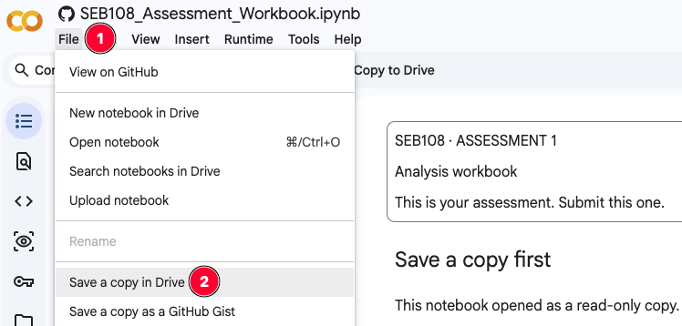
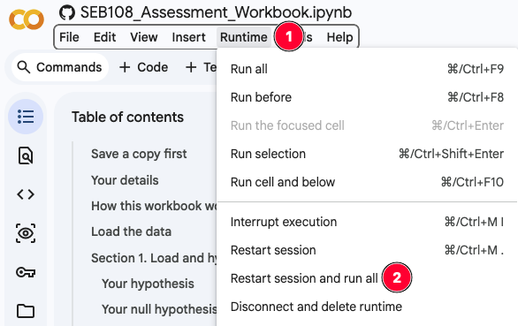

::: {.callout-note}
The first time you open this page, Python takes a few seconds to load. Wait until the code cells show a **Run Code** button.
:::

This is a practical page, not your assessment. You don't hand anything in from here. At the end of today's session you'll open your **assessment workbook** in Colab and start on it.

::: {.callout-tip}
## By the end of this page you'll be able to

- run code cells, and read the errors they give you
- do maths and store results in variables
- load a CSV file into a table with pandas
- look at a table and pick out the rows you want
:::

## 1. Running code on this page

Each grey box below is a **code cell**. Click **Run Code** and the output appears underneath.

```{pyodide}
print("Hello from Python")
```

You can change any cell and run it again. Try changing the message above to your name. If you get a cell into a mess, the **Start Over** button puts back the original code.

Cells on this page share what they've made, so a cell can use a variable made in an earlier cell. That means you need to **run the cells in order, from the top**. If you reload the page, Python forgets everything and you start again from the top.

## 2. Numbers, maths and variables

Python works like a calculator. Say you measured the water temperature in a creek on three days and got 21.5, 19.0 and 25.5 °C. Work out the average on your calculator first, then run the cell and check that Python agrees.

```{pyodide}
(21.5 + 19.0 + 25.5) / 3
```

The brackets matter. Without them, Python divides 25.5 by 3 first and then adds, following the same order of operations as maths. Take the brackets out and run it again to see the difference.

To keep a result, store it in a **variable** with `=`.

```{pyodide}
depth_m = 2.5
width_m = 12
area_m2 = depth_m * width_m
print(area_m2)
```

Names can't have spaces, so use underscores. Good names say what's stored, so `area_m2` is far better than `x`. Names are case-sensitive, which means `Area` and `area` are different variables.

Here are the maths operators you'll use. Anything after a `#` is a **comment**, a note for humans that Python ignores.

```{pyodide}
print(7 + 2)   # add
print(7 - 2)   # subtract
print(7 * 2)   # multiply
print(7 / 2)   # divide
print(7 ** 2)  # to the power of
```

::: {.callout-warning}
Use `**` for powers, never `^`. In Python `^` means something else, and it won't give you an error, just a wrong answer. Try `7 ^ 2` above and see.
:::

Python has two kinds of number. Whole numbers like `12` are **integers** (`int`). Numbers with a decimal point, like `2.5`, are **floats** (`float`). Dividing with `/` always gives a float, even when the answer's a whole number. The `type()` function tells you what kind of value you've got.

```{pyodide}
print(type(12))
print(type(2.5))
print(6 / 3)
```

## 3. Text, and True or False

Text goes in quotes. Python calls it a **string** (`str`).

```{pyodide}
site = "Logan River"
print(site)
print(type(site))
```

When you compare two things, Python gives you `True` or `False`. These answers are called **booleans** (`bool`).

```{pyodide}
reading = 35.0

print(reading > 20)    # greater than
print(reading < 20)    # less than
print(reading >= 35)   # greater than or equal to
print(reading == 35)   # equal to
print(reading != 0)    # not equal to
```

Watch out for `==`. One equals sign **stores** a value, and two **check** whether two things are equal.

You'll use comparisons in Section 8 to pick out the rows you want from a table of data.

## 4. Lists

A **list** holds several values in order, inside square brackets.

```{pyodide}
readings = [12.4, 8.1, 35.0, 9.7, 15.2]
print(readings)
```

Two functions you'll use with lists all the time are `len()`, which counts the items, and `sum()`, which adds them up.

```{pyodide}
print(len(readings))
print(sum(readings))
print(sum(readings) / len(readings))  # the mean
```

You get an item out of a list by its position, called its **index**. Python counts from **0**, so the first item is at index 0. Negative numbers count back from the end.

```{pyodide}
print(readings[0])   # first item
print(readings[2])   # third item
print(readings[-1])  # last item
```

To get several items at once, give a range of positions. This is called **slicing**. The first number is included and the second isn't.

```{pyodide}
print(readings[0:2])  # positions 0 and 1
```

## 5. Calling functions

You've already used several **functions**, including `print()`, `type()`, `len()` and `sum()`. A function is a named bit of code that does a job. You **call** it by writing its name with round brackets, and you put what it needs inside the brackets. The things inside are called **arguments**.

```{pyodide}
print(max(readings))
print(min(readings))
print(round(13.98765, 2))  # 2 decimal places
```

Some arguments have names, and you can write them as `name=value`. These are called **keyword arguments**, and they make code easier to read. The two lines below do the same thing.

```{pyodide}
print(round(13.98765, 2))
print(round(13.98765, ndigits=2))
```

You'll see keyword arguments a lot in data analysis, for example `pd.read_csv("file.csv", sep=",")`.

A **method** is a function that belongs to a value. You call it with a dot after the value.

```{pyodide}
site = "logan river"
print(site.upper())
print(site.title())
```

You'll use methods a lot once you start working with tables of data in Section 7.

If you're not sure what a function does, `help()` will tell you.

```{pyodide}
help(round)
```

Now try it on some of the other functions you've used on this page. Change `max` below to `min`, `len` or `sum` and run it again. The first few lines are the useful part, and you can skip the rest.

```{pyodide}
help(max)
```

## 6. Errors

Errors are normal. Everyone gets them, all the time. Run the cell below to see one.

```{pyodide}
print(rainfall)
```

On this page you only see the message, `name 'rainfall' is not defined`. Python doesn't know anything called `rainfall`, because we never made it.

In Colab you'll see the full error, which can run to several lines. Always **read the last line first**. It starts with the type of error and then the message, so this one would end with `NameError: name 'rainfall' is not defined`.

These are the error types you're most likely to see in this unit.

| Error | What it usually means |
|---|---|
| `NameError` | You've used a variable that doesn't exist yet. Usually a cell was skipped or run out of order, or there's a typo in the name. |
| `SyntaxError` | The code isn't written correctly. Look for a missing bracket, colon or quote mark. |
| `TypeError` | You've mixed types that don't go together, like adding a number to a string. |
| `KeyError` | You've asked for a column name that doesn't exist. Check the spelling, spaces and capitals. |
| `IndexError` | You've asked for a position past the end of a list. |
| `ModuleNotFoundError` | You've tried to import a library that isn't installed, or misspelt its name. |
| `FileNotFoundError` | Python can't find the file you asked for. Check the file name. |

## 7. Loading a table of data with pandas

Real data comes as a table of rows and columns, like a spreadsheet. The Python library for working with tables is called **pandas**. A library is a bundle of extra tools, and you load one with `import`. By convention we give pandas the short name `pd`.

```{pyodide}
import pandas as pd
```

Data files often come as a **CSV** (comma-separated values), a plain text file with one row per line. The `pd.read_csv()` function loads one into a table, which pandas calls a **DataFrame**.

The practicals use real water quality data from the Logan River at Yarrahappini, collected by the Queensland Government. It's laid out exactly like your assessment data. Each row is one measurement of one thing (for example total nitrogen) in one water sample.

```{pyodide}
file = "data/yarrahappini_concentration.csv"
conc = pd.read_csv(file)
conc.head()
```

We've called the table `conc`, short for concentrations. Your assessment workbook uses the same name. The `.head()` method shows the first five rows. Try `conc.head(10)` to see ten.

Before doing anything with a dataset, find out how big it is and what's in it.

```{pyodide}
print(conc.shape)    # (rows, columns)
print(conc.columns)  # the column names
```

The `.dtypes` attribute tells you what kind of data is in each column. `int64` and `float64` are numbers. `object` or `str` means text.

```{pyodide}
conc.dtypes
```

Notice that `Date Time` is text, not a date. You'll deal with that in P2.

## 8. Selecting and filtering

To get one column, put its name in square brackets, in quotes. It has to match exactly, spaces and capitals included.

```{pyodide}
conc["Analyte"]
```

The `.unique()` method lists the different values in a column, and `.value_counts()` counts how many rows have each one.

```{pyodide}
print(conc["Analyte"].unique())
print(conc["Analyte"].value_counts())
```

Now try `.value_counts()` on the site code. There's only one site in this file, so you'd expect one row in the answer.

```{pyodide}
conc["Site Code"].value_counts()
```

Look closely. There are two entries that look the same, because one of them has a space on the end. To Python that's a different site code, so filtering for `"145014A"` would miss that row. Real data is full of small problems like this, and `.value_counts()` is one of the best ways to spot them. You'll learn to fix them in P2.

You can do maths on a column of numbers. Only do it on one analyte at a time, though. An average of nitrogen and sediment values mixed together means nothing.

To **filter** rows, put a comparison inside square brackets. You get back only the rows where the comparison is `True`.

```{pyodide}
tss = conc[conc["Analyte"] == "Total suspended solids"]
print(len(tss), "rows")
print(tss["Value"].mean())
```

To filter on two things at once, join the comparisons with `&` (and). Storing each comparison in a variable first keeps it readable.

```{pyodide}
is_tss = conc["Analyte"] == "Total suspended solids"
is_good = conc["Quality Code"] == 10

good_tss = conc[is_tss & is_good]
print(len(good_tss), "rows")
print(good_tss["Value"].mean())
```

Quality code 10 means WQI rates the result as good. You'll decide which quality codes to keep in P2.

::: {.callout-caution}
## Common mistakes

- Running cells out of order, so a variable doesn't exist yet (`NameError`)
- Using `=` when you mean `==`. One stores a value, and two compare
- A column name that doesn't match exactly, including capitals and spaces (`KeyError`)
- Forgetting the quotes around text, like a site code or an analyte name
:::

## In-class activities

Work through these in order. Each one says which sections it needs, so go back and check if you're stuck. Each exercise has hints and a solution, but have a real go before you look.

Every exercise starts fresh, so the data is loaded for you where it's needed.

### Activity 1. Variables and maths

You'll need section 2.

A water sample has a total nitrogen concentration of 0.85 mg/L, and the river is carrying 1,200 megalitres (ML) of water a day. Work out how many kilograms of nitrogen the river carries in a day.

Handily, mg/L multiplied by ML gives you kg straight away, because a megalitre is a million litres and a kilogram is a million milligrams.

```{pyodide}
#| exercise: ex_load_maths
tn_mg_per_L = 0.85
flow_ML_per_day = 1200

load_kg_per_day = ______
print(load_kg_per_day)
```

::: {.hint exercise="ex_load_maths"}
Multiply the two variables together.
:::

::: {.hint exercise="ex_load_maths"}
`load_kg_per_day = tn_mg_per_L * flow_ML_per_day`
:::

::: {.solution exercise="ex_load_maths"}
```python
tn_mg_per_L = 0.85
flow_ML_per_day = 1200

load_kg_per_day = tn_mg_per_L * flow_ML_per_day
print(load_kg_per_day)
```
:::

### Activity 2. Load and look

You'll need section 7.

Load the practical data, then find out how many rows and columns it has, what the columns are called, and which columns hold numbers.

```{pyodide}
#| exercise: ex_look
import pandas as pd

file = "data/yarrahappini_concentration.csv"
conc = ______(file)

print(conc.______)
print(conc.______)
print(conc.______)
```

::: {.hint exercise="ex_look"}
The function that loads a CSV is in pandas, so it starts with `pd.` After that you need `shape`, `columns` and `dtypes`.
:::

::: {.hint exercise="ex_look"}
`conc = pd.read_csv(file)`. Note that `shape`, `columns` and `dtypes` don't need round brackets after them.
:::

::: {.solution exercise="ex_look"}
```python
import pandas as pd

file = "data/yarrahappini_concentration.csv"
conc = pd.read_csv(file)

print(conc.shape)
print(conc.columns)
print(conc.dtypes)
```
:::

### Activity 3. What's in the data?

You'll need section 8.

Find out which analytes were measured, which quality codes appear, and how the samples were collected. Then answer the questions below the cell.

```{pyodide}
#| exercise: ex_whats_in
#| setup: true
import pandas as pd
conc = pd.read_csv("data/yarrahappini_concentration.csv")
```

```{pyodide}
#| exercise: ex_whats_in
print(conc["Analyte"].______())
print(conc["Quality Code"].______())
print(conc["Collection Method"].______())
```

::: {.hint exercise="ex_whats_in"}
You want a method that counts how many rows have each value.
:::

::: {.hint exercise="ex_whats_in"}
Use `.value_counts()` on all three columns.
:::

::: {.solution exercise="ex_whats_in"}
```python
print(conc["Analyte"].value_counts())
print(conc["Quality Code"].value_counts())
print(conc["Collection Method"].value_counts())
```
:::

How many different analytes are there? Which quality codes appear, and roughly what share of the rows aren't code 10? How were most samples collected?

### Activity 4. One analyte

You'll need section 8.

Pick out the **total nitrogen** rows (the analyte is called `"Total nitrogen as N"`). Print how many rows there are, then the mean and the biggest value.

```{pyodide}
#| exercise: ex_one_analyte
#| setup: true
import pandas as pd
conc = pd.read_csv("data/yarrahappini_concentration.csv")
```

```{pyodide}
#| exercise: ex_one_analyte
is_tn = conc["Analyte"] == ______
tn = conc[is_tn]

print(len(tn), "rows")
print("Mean", tn["Value"].______())
print("Biggest", tn["Value"].______())
```

::: {.hint exercise="ex_one_analyte"}
The analyte name is text, so it needs quotes, and it has to match the data exactly. Use `.mean()` and `.max()` for the last two lines.
:::

::: {.hint exercise="ex_one_analyte"}
`is_tn = conc["Analyte"] == "Total nitrogen as N"`
:::

::: {.solution exercise="ex_one_analyte"}
```python
is_tn = conc["Analyte"] == "Total nitrogen as N"
tn = conc[is_tn]

print(len(tn), "rows")
print("Mean", tn["Value"].mean())
print("Biggest", tn["Value"].max())
```
:::

The biggest value is far bigger than the mean. Change your code to show the rows where the value is over 100, with `tn[tn["Value"] > 100]`. Look at the `Unit` column for that row. What do you think has happened? You'll come back to this in P2.

## Your workbook code, copy from here

This is the code for Section 1 of your assessment workbook. Run it here first to see what it does. Then copy it into your workbook and change the two lines at the top to your own site code and analyte.

```{pyodide}
#| exercise: workbook_code
#| setup: true
import pandas as pd
conc = pd.read_csv("data/yarrahappini_concentration.csv")
```

```{pyodide}
#| exercise: workbook_code
#| caption: Your workbook code
# Change these to your site and analyte
my_site = "145014A"
my_analyte = "Total suspended solids"

# What's in the data?
print(conc.shape)
print(conc["Site Code"].value_counts())
print(conc["Analyte"].value_counts())

# Pick out your site and analyte
is_site = conc["Site Code"] == my_site
is_analyte = conc["Analyte"] == my_analyte
my_data = conc[is_site & is_analyte]
print(len(my_data), "rows")
my_data.head()
```

In your workbook, `conc` is already loaded for you by the first cells, so you don't need the `pd.read_csv()` line.

## Bridge to your assessment

Your assessment workbook isn't on this page. It's a **Google Colab** notebook, and you'll switch to it now. Colab runs Python too, but it works a bit differently. You'll need a Google account.

### Opening your workbook

Click the **Open in Colab** button on the Canvas assessment page. The workbook opens as a read-only copy, so go straight to **File > Save a copy in Drive** and work in the copy that opens. Its name starts with "Copy of". If you skip this step, your work won't be saved.

<!-- SCREENSHOT PLACEHOLDER for Michael. Save the screenshot as practicals/images/p1-colab-save-copy.png, then delete this line and the last line of this comment so the image line below shows.
{fig-alt="The Colab File menu open, with Save a copy in Drive highlighted."}
-->

Your copy lives in your Google Drive, in a folder called Colab Notebooks. Next time, open it from there, not from the Canvas button.

### Running cells

Click the play button on the left of a cell, or press **Shift + Enter**. Like this page, Colab remembers what you've run in the order you ran it.

Colab also has text cells for writing. Double-click one to edit it, and press **Shift + Enter** when you're done.

### Starting fresh

The **Runtime > Restart session and run all** menu option wipes everything and runs every cell from the top. Your workbook has to pass this test, and you'll do it at each check-off.

<!-- SCREENSHOT PLACEHOLDER for Michael. Save the screenshot as practicals/images/p1-colab-restart-run-all.png, then delete this line and the last line of this comment so the image line below shows.
{fig-alt="The Colab Runtime menu open, with Restart session and run all highlighted."}
-->

### GenAI

Colab may offer to write code for you. You can use GenAI on your workbook, but not during check-offs, where you run and explain your analysis yourself. Make sure you understand every line.

### Your first steps

Your assessment data has the same columns as the practical data, so you'll do the same first steps on it.

1. Open your **assessment workbook** from the **Open in Colab** button on Canvas.
2. Go to **File > Save a copy in Drive**, and work in your copy from now on.
3. Run the loader cell, then the sanity-check cell. Check the number of rows and the first few rows look sensible.
4. Find your allocated site and pollutant on the **Assessment Brief and Data** page on Canvas. It depends on the last digit of your student number.
5. Paste your workbook code into Section 1. Change `my_site` and `my_analyte` to your site code and analyte, written exactly as they appear in the data, and run it.
6. Write your hypothesis, null hypothesis and predicted direction (wet or dry season higher, and why) in Section 1.

::: {.checkoff}
### Check-off 1

When you're ready, put your hand up and show your demonstrator your workbook with these done.

- Your own saved copy is open in Colab (its name starts with "Copy of").
- The loader and sanity-check cells have run.
- Your Section 1 code has run for your allocated site and pollutant.
- Your hypothesis, null hypothesis and predicted direction are written in Section 1.

You'll run your code in front of them without GenAI, and they'll ask you a question or two about it. If you don't get there today, you can catch up at a later practical or the Week 12 drop-in.
:::

## Help and resources

These are optional, for when you want more practice or a different explanation.

- [Colab basic features](https://colab.research.google.com/notebooks/basic_features_overview.ipynb). Google's own short tour of Colab
- [Colab questions and answers](https://research.google.com/colaboratory/faq.html). Answers to common Colab questions, like where your files are saved
- [Getting started with pandas](https://pandas.pydata.org/docs/getting_started/intro_tutorials/index.html). Short official tutorials on loading and looking at tables
