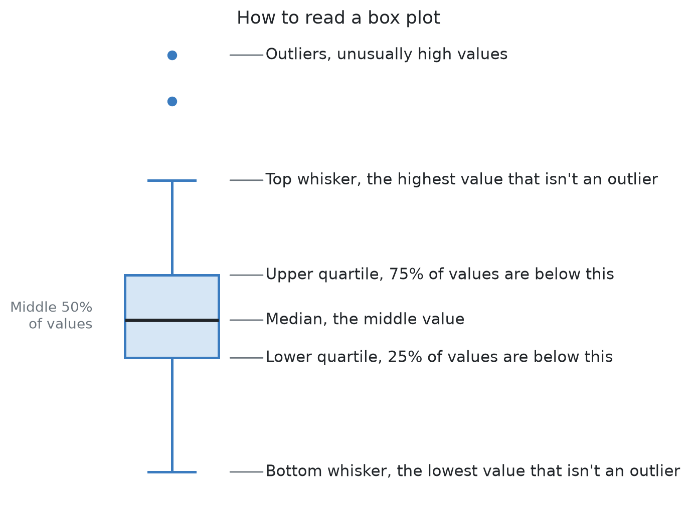
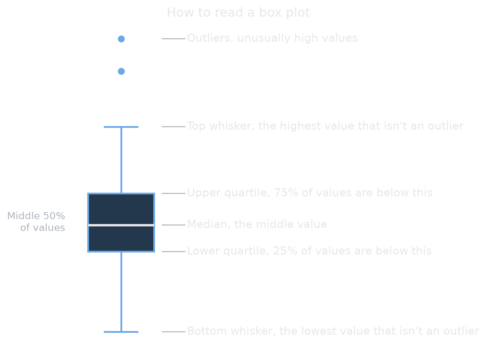

::: {.callout-note}
The first time you open this page, Python takes a few seconds to load. Wait until the code cells show a **Run Code** button.
:::

In P3 you described and tested your data. Now you'll show it. A good plot lets someone see your answer at a glance, and it's what WQI will look at first in your report. A bad plot can make a small difference look huge, or hide a real one.

On this page we'll keep using **total suspended solids** (TSS) at the Logan River at Yarrahappini, the same data as P3.

::: {.callout-tip}
## By the end of this page you'll be able to

- make a plot with a title and labelled axes, including units
- compare two groups with a box plot
- deal with skewed data using a log scale or by zooming in
- show uncertainty with notches
:::

## 1. Start from clean data

As in P3, this cell repeats the P2 cleaning for TSS and runs by itself when the page loads. Scroll inside it if you want to look.

```{pyodide}
#| autorun: true
#| max-lines: 8
#| caption: Cleaning from P2
import pandas as pd
import matplotlib.pyplot as plt

conc = pd.read_csv("data/yarrahappini_concentration.csv")
my_site = "145014A"
my_analyte = "Total suspended solids"

# Tidy stray spaces
clean = conc.copy()
for col in ["Site Code", "Analyte", "Unit", "Operator"]:
    clean[col] = clean[col].str.strip()

# Your site and pollutant
is_site = clean["Site Code"] == my_site
is_analyte = clean["Analyte"] == my_analyte
clean = clean[is_site & is_analyte].copy()
print(len(clean), "rows to start")

# Quality codes (your decision)
keep_codes = [10]
before = len(clean)
clean = clean[clean["Quality Code"].isin(keep_codes)]
print(before - len(clean), "removed by quality code")

# Blank values
before = len(clean)
clean = clean.dropna(subset=["Value"])
print(before - len(clean), "removed as blank")

# "<" values (your decision). To drop them,
# remove the # from the start of the next line.
# clean = clean[clean["Operator"] != "<"]
lt = (clean["Operator"] == "<").sum()
print(lt, "rows below the detection limit kept")

# Units
is_ug = clean["Unit"] == "Micrograms/Litre"
print(is_ug.sum(), "values converted from micrograms")
ug_values = clean.loc[is_ug, "Value"]
clean.loc[is_ug, "Value"] = ug_values / 1000
clean.loc[is_ug, "Unit"] = "Milligrams/Litre"

# Duplicates
before = len(clean)
clean = clean.drop_duplicates()
print(before - len(clean), "removed as duplicates")

# Dates, month first, then fix the odd ones
fmt = "%m/%d/%y %H:%M"
dates = pd.to_datetime(clean["Date Time"], format=fmt,
                       errors="coerce")
odd = clean.loc[dates.isna(), "Date Time"]
print("Dates that didn't fit")
print(odd)
fixed = pd.to_datetime(odd, format="mixed")
clean["Date"] = dates.fillna(fixed)

# Dates outside the monitoring period (your decision)
first_date = "2007-07-01"
before = len(clean)
clean = clean[clean["Date"] >= first_date]
print(before - len(clean), "removed as out of range")

# Seasons
wet_months = [10, 11, 12, 1, 2, 3]
clean["Season"] = "Dry"
is_wet = clean["Date"].dt.month.isin(wet_months)
clean.loc[is_wet, "Season"] = "Wet"
wet = clean[clean["Season"] == "Wet"]
dry = clean[clean["Season"] == "Dry"]
print(len(wet), "wet and", len(dry), "dry samples")
```

## 2. Making a plot

The `matplotlib` library draws plots. Every plot on this page follows the same pattern.

```{pyodide}
import matplotlib.pyplot as plt

fig, ax = plt.subplots()
ax.hist(wet["Value"], bins=40)
ax.set_xlabel("TSS (mg/L)")
ax.set_ylabel("Number of samples")
ax.set_title("Wet season TSS at Yarrahappini")
plt.show()
```

The `plt.subplots()` function gives you two things at once. The first, `fig`, is the whole picture. The second, `ax`, is the plot area you draw on. Then you add things to `ax`, here a histogram, two axis labels and a title, and `plt.show()` draws it.

Every plot you make should have a title, and a label on each axis that includes the **units**. Without them, nobody can tell what they're looking at.

## 3. What not to do

A bar chart of the means looks like an obvious way to compare two seasons.

```{pyodide}
means = clean.groupby("Season")["Value"].mean()

fig, ax = plt.subplots()
ax.bar(means.index, means.values)
ax.set_ylabel("Mean TSS (mg/L)")
ax.set_title("Mean TSS by season")
plt.show()
```

It looks like a clear difference. But P3 showed the t-test couldn't find one, because the means are pulled around by a few huge flood samples. This plot hides everything that matters. You can't see how spread out the values are, how skewed they are, or how many samples are behind each bar. Avoid bar charts of means for data like this, and never use a pie chart to compare groups.

## 4. Box plots

A **box plot** shows the whole spread of the data in a small space, so it's one of the best ways to compare groups.

{.light-content fig-alt="A labelled box plot. The box runs from the lower quartile, where 25% of values are below, to the upper quartile, where 75% of values are below, so it holds the middle 50% of values. A thick line across the box marks the median. Whiskers extend above and below the box to the highest and lowest values that aren't outliers, and two dots above the top whisker are outliers, unusually high values."}
{.dark-content fig-alt="A labelled box plot. The box runs from the lower quartile, where 25% of values are below, to the upper quartile, where 75% of values are below, so it holds the middle 50% of values. A thick line across the box marks the median. Whiskers extend above and below the box to the highest and lowest values that aren't outliers, and two dots above the top whisker are outliers, unusually high values."}

Here are the two seasons side by side. The `ax.boxplot()` method takes a list of the groups to draw, and `ax.set_xticks()` names them.

```{pyodide}
fig, ax = plt.subplots()
ax.boxplot([wet["Value"], dry["Value"]])
ax.set_xticks([1, 2], ["Wet", "Dry"])
ax.set_ylabel("TSS (mg/L)")
ax.set_title("TSS at Yarrahappini by season")
plt.show()
```

That's the same squashed look you saw in P3. The flood samples stretch the axis so far that both boxes are crushed flat at the bottom, with a long column of outlier dots above them.

## 5. Dealing with skew

There are two common fixes. Each tells the truth, as long as you say what you've done.

### Zoom in

Setting the limits of the axis zooms in on the part you care about. Here, `ax.set_ylim()` shows 0 to 2,000 mg/L.

```{pyodide}
fig, ax = plt.subplots()
ax.boxplot([wet["Value"], dry["Value"]])
ax.set_xticks([1, 2], ["Wet", "Dry"])
ax.set_ylim(0, 2000)
ax.set_ylabel("TSS (mg/L)")
ax.set_title("TSS by season, zoomed to 0 to 2,000 mg/L")
plt.show()
```

Now you can compare the boxes. The wet season box and median sit clearly higher. But the biggest values are off the top of the plot, so say so in the title or caption.

### Use a log scale

On a **log scale**, each step up the axis is ten times the one before, so 10, 100, 1,000. Small values get spread out and huge ones get pulled in, so you can see all the data at once. The `ax.set_yscale("log")` method turns it on.

```{pyodide}
fig, ax = plt.subplots()
ax.boxplot([wet["Value"], dry["Value"]])
ax.set_xticks([1, 2], ["Wet", "Dry"])
ax.set_yscale("log")
ax.set_ylabel("TSS (mg/L, log scale)")
ax.set_title("TSS at Yarrahappini by season")
plt.show()
```

Every sample is on the plot, and the difference between the seasons is easy to see. Always put "log scale" in the axis label, because readers will misjudge the gaps if they don't know.

Which should you use? A log scale keeps every value on the plot, so it's usually the better choice for skewed data. Zooming is simpler to read if your audience isn't used to log scales. Either is fine if you explain your choice.

::: {.callout-tip collapse="true"}
## Optional. Comparing shapes with histograms

Histograms show the shape of each season in more detail. To compare two seasons with different numbers of samples, add `density=True`, so each histogram is scaled to the same total area. The `alpha` argument makes the bars see-through so both show, and `range` zooms in.

```{pyodide}
fig, ax = plt.subplots()
ax.hist(wet["Value"], bins=40, range=(0, 2000),
        density=True, alpha=0.5, label="Wet")
ax.hist(dry["Value"], bins=40, range=(0, 2000),
        density=True, alpha=0.5, label="Dry")
ax.set_xlabel("TSS (mg/L)")
ax.set_ylabel("Density")
ax.set_title("TSS by season, 0 to 2,000 mg/L")
ax.legend()
plt.show()
```

The `label` arguments and `ax.legend()` add a key, so readers know which colour is which. The dry season has more very low values, while the wet season spreads further to the right.
:::

## 6. Showing uncertainty

A median worked out from a sample is only an estimate. With a different set of samples, you'd get a slightly different median. A good plot shows how uncertain it is.

Adding `notch=True` to a box plot gives each box a **notch**, a narrowing around the median line. The notch is roughly a 95% confidence interval for the median. That means it's the range we're fairly confident the true median falls in.

```{pyodide}
labels = ["Wet (n = " + str(len(wet)) + ")",
          "Dry (n = " + str(len(dry)) + ")"]

fig, ax = plt.subplots()
ax.boxplot([wet["Value"], dry["Value"]], notch=True)
ax.set_xticks([1, 2], labels)
ax.set_yscale("log")
ax.set_xlabel("Season")
ax.set_ylabel("TSS (mg/L, log scale)")
ax.set_title("TSS at Yarrahappini by season")
plt.show()
```

The first two lines make labels that include how many samples are in each season. The `len()` function counts them, `str()` turns a number into text, and `+` joins pieces of text together.

Here's how to read the notches.

- If the notches of two boxes **don't overlap**, that's good evidence the medians really are different. Here they don't overlap, which fits with the Mann-Whitney test in P3.
- If they **do overlap**, the medians might not really differ.
- A notch is wider when there are fewer samples, because fewer samples means more uncertainty. That's why it's useful to show n in the labels.

The notch is an approximate guide, not a test. Use it alongside your test from P3, not instead of it.

::: {.callout-tip collapse="true"}
## Optional. A confidence interval for the mean

You can also work out a 95% confidence interval for the **mean**. It comes from the **standard error**, the standard deviation divided by the square root of the number of samples. The interval stretches 1.96 standard errors either side of the mean, and `** 0.5` takes a square root.

```{pyodide}
summary = clean.groupby("Season")["Value"].agg(
    ["mean", "std", "count"])
se = summary["std"] / summary["count"] ** 0.5
summary["ci"] = 1.96 * se
summary.round(1)
```

The wet season mean is 476 ± 54 mg/L, and the dry season mean is 378 ± 88 mg/L. Those intervals overlap. For skewed data like this, though, the mean isn't the best summary, so the notched box plot is the more useful picture.
:::

## 7. Is your hypothesis supported?

Now bring everything together, your summary table, your test, your check and your plot. For TSS at Yarrahappini, it might look like this.

> Wet season TSS tended to be higher than dry season TSS. The medians were 223 and 128 mg/L, and on the notched box plot the wet season box sits higher, with notches that don't overlap. A Mann-Whitney U test found this difference was significant (p < 0.001). However, the means were not significantly different (t-test p = 0.075), because a few very large flood samples make the means highly variable. Overall the evidence supports the hypothesis that TSS differs between seasons, with higher values in the wet season.

A good figure for your workbook has all of these.

- A title that says what's being compared, and where
- Axis labels with units, and "log scale" if you used one
- Something that shows the spread of the data, not just an average
- Something that shows uncertainty, like notches, with the number of samples
- An honest axis, with any zooming explained

::: {.callout-caution}
## Common mistakes

- Leaving out units, or using a log scale without saying so in the label
- Using a bar chart of means, which hides the spread of the data
- Zooming in without saying that some values are off the plot
- Treating overlapping notches as proof there's no difference. They're a guide, not a test
:::

## In-class activities

Each exercise starts with that pollutant's data already cleaned, as `clean`, `wet` and `dry`, and `plt` already loaded. Have a real go before you look at the hints.

### Activity 1. Choose and label a plot

You'll need sections 2 and 4.

Make a labelled box plot comparing the seasons for **dissolved organic nitrogen**.

```{pyodide}
#| exercise: ex_box
#| setup: true
import pandas as pd
import matplotlib.pyplot as plt
conc = pd.read_csv("data/yarrahappini_concentration.csv")
my_site = "145014A"
my_analyte = "Dissolved organic nitrogen as N"
# Tidy stray spaces
clean = conc.copy()
for col in ["Site Code", "Analyte", "Unit", "Operator"]:
    clean[col] = clean[col].str.strip()

# Your site and pollutant
is_site = clean["Site Code"] == my_site
is_analyte = clean["Analyte"] == my_analyte
clean = clean[is_site & is_analyte].copy()
print(len(clean), "rows to start")

# Quality codes (your decision)
keep_codes = [10]
before = len(clean)
clean = clean[clean["Quality Code"].isin(keep_codes)]
print(before - len(clean), "removed by quality code")

# Blank values
before = len(clean)
clean = clean.dropna(subset=["Value"])
print(before - len(clean), "removed as blank")

# "<" values (your decision). To drop them,
# remove the # from the start of the next line.
# clean = clean[clean["Operator"] != "<"]
lt = (clean["Operator"] == "<").sum()
print(lt, "rows below the detection limit kept")

# Units
is_ug = clean["Unit"] == "Micrograms/Litre"
print(is_ug.sum(), "values converted from micrograms")
ug_values = clean.loc[is_ug, "Value"]
clean.loc[is_ug, "Value"] = ug_values / 1000
clean.loc[is_ug, "Unit"] = "Milligrams/Litre"

# Duplicates
before = len(clean)
clean = clean.drop_duplicates()
print(before - len(clean), "removed as duplicates")

# Dates, month first, then fix the odd ones
fmt = "%m/%d/%y %H:%M"
dates = pd.to_datetime(clean["Date Time"], format=fmt,
                       errors="coerce")
odd = clean.loc[dates.isna(), "Date Time"]
print("Dates that didn't fit")
print(odd)
fixed = pd.to_datetime(odd, format="mixed")
clean["Date"] = dates.fillna(fixed)

# Dates outside the monitoring period (your decision)
first_date = "2007-07-01"
before = len(clean)
clean = clean[clean["Date"] >= first_date]
print(before - len(clean), "removed as out of range")

# Seasons
wet_months = [10, 11, 12, 1, 2, 3]
clean["Season"] = "Dry"
is_wet = clean["Date"].dt.month.isin(wet_months)
clean.loc[is_wet, "Season"] = "Wet"
wet = clean[clean["Season"] == "Wet"]
dry = clean[clean["Season"] == "Dry"]
print(len(wet), "wet and", len(dry), "dry samples")
```

```{pyodide}
#| exercise: ex_box
fig, ax = plt.subplots()
ax.______([wet["Value"], dry["Value"]])
ax.set_xticks([1, 2], ["Wet", "Dry"])
ax.set_ylabel(______)
ax.set_title(______)
plt.show()
```

::: {.hint exercise="ex_box"}
The method that draws a box plot is in section 4. The label and title are text, so they need quotes, and the label needs units.
:::

::: {.hint exercise="ex_box"}
Use `ax.boxplot`, a label like `"Dissolved organic N (mg/L)"` and a title like `"Dissolved organic N at Yarrahappini"`.
:::

::: {.solution exercise="ex_box"}
```python
fig, ax = plt.subplots()
ax.boxplot([wet["Value"], dry["Value"]])
ax.set_xticks([1, 2], ["Wet", "Dry"])
ax.set_ylabel("Dissolved organic N (mg/L)")
ax.set_title("Dissolved organic N at Yarrahappini")
plt.show()
```
:::

What does your box plot show that a bar chart of the means couldn't? Is one season clearly higher?

### Activity 2. Use a log scale

You'll need section 5.

The **particulate nitrogen** box plot below is squashed by outliers. Switch it to a log scale, and fix the axis label to say so.

```{pyodide}
#| exercise: ex_log
#| setup: true
import pandas as pd
import matplotlib.pyplot as plt
conc = pd.read_csv("data/yarrahappini_concentration.csv")
my_site = "145014A"
my_analyte = "Particulate nitrogen as N"
# Tidy stray spaces
clean = conc.copy()
for col in ["Site Code", "Analyte", "Unit", "Operator"]:
    clean[col] = clean[col].str.strip()

# Your site and pollutant
is_site = clean["Site Code"] == my_site
is_analyte = clean["Analyte"] == my_analyte
clean = clean[is_site & is_analyte].copy()
print(len(clean), "rows to start")

# Quality codes (your decision)
keep_codes = [10]
before = len(clean)
clean = clean[clean["Quality Code"].isin(keep_codes)]
print(before - len(clean), "removed by quality code")

# Blank values
before = len(clean)
clean = clean.dropna(subset=["Value"])
print(before - len(clean), "removed as blank")

# "<" values (your decision). To drop them,
# remove the # from the start of the next line.
# clean = clean[clean["Operator"] != "<"]
lt = (clean["Operator"] == "<").sum()
print(lt, "rows below the detection limit kept")

# Units
is_ug = clean["Unit"] == "Micrograms/Litre"
print(is_ug.sum(), "values converted from micrograms")
ug_values = clean.loc[is_ug, "Value"]
clean.loc[is_ug, "Value"] = ug_values / 1000
clean.loc[is_ug, "Unit"] = "Milligrams/Litre"

# Duplicates
before = len(clean)
clean = clean.drop_duplicates()
print(before - len(clean), "removed as duplicates")

# Dates, month first, then fix the odd ones
fmt = "%m/%d/%y %H:%M"
dates = pd.to_datetime(clean["Date Time"], format=fmt,
                       errors="coerce")
odd = clean.loc[dates.isna(), "Date Time"]
print("Dates that didn't fit")
print(odd)
fixed = pd.to_datetime(odd, format="mixed")
clean["Date"] = dates.fillna(fixed)

# Dates outside the monitoring period (your decision)
first_date = "2007-07-01"
before = len(clean)
clean = clean[clean["Date"] >= first_date]
print(before - len(clean), "removed as out of range")

# Seasons
wet_months = [10, 11, 12, 1, 2, 3]
clean["Season"] = "Dry"
is_wet = clean["Date"].dt.month.isin(wet_months)
clean.loc[is_wet, "Season"] = "Wet"
wet = clean[clean["Season"] == "Wet"]
dry = clean[clean["Season"] == "Dry"]
print(len(wet), "wet and", len(dry), "dry samples")
```

```{pyodide}
#| exercise: ex_log
fig, ax = plt.subplots()
ax.boxplot([wet["Value"], dry["Value"]])
ax.set_xticks([1, 2], ["Wet", "Dry"])
ax.set_yscale(______)
ax.set_ylabel(______)
ax.set_title("Particulate N at Yarrahappini")
plt.show()
```

::: {.hint exercise="ex_log"}
The scale you want is called `"log"`. The label should give the pollutant, its units and the scale.
:::

::: {.hint exercise="ex_log"}
Use `ax.set_yscale("log")` and a label like `"Particulate N (mg/L, log scale)"`.
:::

::: {.solution exercise="ex_log"}
```python
fig, ax = plt.subplots()
ax.boxplot([wet["Value"], dry["Value"]])
ax.set_xticks([1, 2], ["Wet", "Dry"])
ax.set_yscale("log")
ax.set_ylabel("Particulate N (mg/L, log scale)")
ax.set_title("Particulate N at Yarrahappini")
plt.show()
```
:::

In P3, the t-test found no difference for particulate nitrogen, but Mann-Whitney did. Does the box plot help you see why?

### Activity 3. Notches

You'll need sections 5 and 6.

Make a notched box plot on a log scale for **filterable reactive phosphorus**, with the number of samples in each label.

```{pyodide}
#| exercise: ex_notch
#| setup: true
import pandas as pd
import matplotlib.pyplot as plt
conc = pd.read_csv("data/yarrahappini_concentration.csv")
my_site = "145014A"
my_analyte = "Filterable Reactive phosphorus as P"
# Tidy stray spaces
clean = conc.copy()
for col in ["Site Code", "Analyte", "Unit", "Operator"]:
    clean[col] = clean[col].str.strip()

# Your site and pollutant
is_site = clean["Site Code"] == my_site
is_analyte = clean["Analyte"] == my_analyte
clean = clean[is_site & is_analyte].copy()
print(len(clean), "rows to start")

# Quality codes (your decision)
keep_codes = [10]
before = len(clean)
clean = clean[clean["Quality Code"].isin(keep_codes)]
print(before - len(clean), "removed by quality code")

# Blank values
before = len(clean)
clean = clean.dropna(subset=["Value"])
print(before - len(clean), "removed as blank")

# "<" values (your decision). To drop them,
# remove the # from the start of the next line.
# clean = clean[clean["Operator"] != "<"]
lt = (clean["Operator"] == "<").sum()
print(lt, "rows below the detection limit kept")

# Units
is_ug = clean["Unit"] == "Micrograms/Litre"
print(is_ug.sum(), "values converted from micrograms")
ug_values = clean.loc[is_ug, "Value"]
clean.loc[is_ug, "Value"] = ug_values / 1000
clean.loc[is_ug, "Unit"] = "Milligrams/Litre"

# Duplicates
before = len(clean)
clean = clean.drop_duplicates()
print(before - len(clean), "removed as duplicates")

# Dates, month first, then fix the odd ones
fmt = "%m/%d/%y %H:%M"
dates = pd.to_datetime(clean["Date Time"], format=fmt,
                       errors="coerce")
odd = clean.loc[dates.isna(), "Date Time"]
print("Dates that didn't fit")
print(odd)
fixed = pd.to_datetime(odd, format="mixed")
clean["Date"] = dates.fillna(fixed)

# Dates outside the monitoring period (your decision)
first_date = "2007-07-01"
before = len(clean)
clean = clean[clean["Date"] >= first_date]
print(before - len(clean), "removed as out of range")

# Seasons
wet_months = [10, 11, 12, 1, 2, 3]
clean["Season"] = "Dry"
is_wet = clean["Date"].dt.month.isin(wet_months)
clean.loc[is_wet, "Season"] = "Wet"
wet = clean[clean["Season"] == "Wet"]
dry = clean[clean["Season"] == "Dry"]
print(len(wet), "wet and", len(dry), "dry samples")
```

```{pyodide}
#| exercise: ex_notch
labels = ["Wet (n = " + str(______(wet)) + ")",
          "Dry (n = " + str(______(dry)) + ")"]

fig, ax = plt.subplots()
ax.boxplot([wet["Value"], dry["Value"]], notch=______)
ax.set_xticks([1, 2], labels)
ax.set_yscale(______)
ax.set_xlabel("Season")
ax.set_ylabel("FRP (mg/L, log scale)")
ax.set_title("FRP at Yarrahappini by season")
plt.show()
```

::: {.hint exercise="ex_notch"}
The function that counts the rows is the same one you used on lists in P1. Notches are turned on with `True`, and the scale you want is `"log"`.
:::

::: {.hint exercise="ex_notch"}
Use `len`, `len`, `True` and `"log"`.
:::

::: {.solution exercise="ex_notch"}
```python
labels = ["Wet (n = " + str(len(wet)) + ")",
          "Dry (n = " + str(len(dry)) + ")"]

fig, ax = plt.subplots()
ax.boxplot([wet["Value"], dry["Value"]], notch=True)
ax.set_xticks([1, 2], labels)
ax.set_yscale("log")
ax.set_xlabel("Season")
ax.set_ylabel("FRP (mg/L, log scale)")
ax.set_title("FRP at Yarrahappini by season")
plt.show()
```
:::

Do the notches overlap? Which season's notch is wider, and why? Does the plot agree with the tests you ran on FRP in P3?

## Your workbook code, copy from here

This is the code for Section 4 of your assessment workbook. It draws a notched box plot of the two seasons, labelled with your pollutant, your site and the number of samples, and prints the median for each season. It uses `clean`, `wet`, `dry`, `my_site` and `my_analyte` from your earlier sections, so run them first.

The log scale is your decision. To turn it off, put a `#` in front of both lines below "Log scale".

```{pyodide}
#| exercise: workbook_code
#| setup: true
import pandas as pd
conc = pd.read_csv("data/yarrahappini_concentration.csv")
my_site = "145014A"
my_analyte = "Total suspended solids"
# Tidy stray spaces
clean = conc.copy()
for col in ["Site Code", "Analyte", "Unit", "Operator"]:
    clean[col] = clean[col].str.strip()

# Your site and pollutant
is_site = clean["Site Code"] == my_site
is_analyte = clean["Analyte"] == my_analyte
clean = clean[is_site & is_analyte].copy()
print(len(clean), "rows to start")

# Quality codes (your decision)
keep_codes = [10]
before = len(clean)
clean = clean[clean["Quality Code"].isin(keep_codes)]
print(before - len(clean), "removed by quality code")

# Blank values
before = len(clean)
clean = clean.dropna(subset=["Value"])
print(before - len(clean), "removed as blank")

# "<" values (your decision). To drop them,
# remove the # from the start of the next line.
# clean = clean[clean["Operator"] != "<"]
lt = (clean["Operator"] == "<").sum()
print(lt, "rows below the detection limit kept")

# Units
is_ug = clean["Unit"] == "Micrograms/Litre"
print(is_ug.sum(), "values converted from micrograms")
ug_values = clean.loc[is_ug, "Value"]
clean.loc[is_ug, "Value"] = ug_values / 1000
clean.loc[is_ug, "Unit"] = "Milligrams/Litre"

# Duplicates
before = len(clean)
clean = clean.drop_duplicates()
print(before - len(clean), "removed as duplicates")

# Dates, month first, then fix the odd ones
fmt = "%m/%d/%y %H:%M"
dates = pd.to_datetime(clean["Date Time"], format=fmt,
                       errors="coerce")
odd = clean.loc[dates.isna(), "Date Time"]
print("Dates that didn't fit")
print(odd)
fixed = pd.to_datetime(odd, format="mixed")
clean["Date"] = dates.fillna(fixed)

# Dates outside the monitoring period (your decision)
first_date = "2007-07-01"
before = len(clean)
clean = clean[clean["Date"] >= first_date]
print(before - len(clean), "removed as out of range")

# Seasons
wet_months = [10, 11, 12, 1, 2, 3]
clean["Season"] = "Dry"
is_wet = clean["Date"].dt.month.isin(wet_months)
clean.loc[is_wet, "Season"] = "Wet"
wet = clean[clean["Season"] == "Wet"]
dry = clean[clean["Season"] == "Dry"]
print(len(wet), "wet and", len(dry), "dry samples")
```

```{pyodide}
#| exercise: workbook_code
#| caption: Your workbook code
import matplotlib.pyplot as plt

# Labels with the number of samples
labels = ["Wet (n = " + str(len(wet)) + ")",
          "Dry (n = " + str(len(dry)) + ")"]

# Notched box plot of the two seasons
fig, ax = plt.subplots()
ax.boxplot([wet["Value"], dry["Value"]], notch=True)
ax.set_xticks([1, 2], labels)
ax.set_xlabel("Season")
ax.set_ylabel("Concentration (mg/L)")
# Log scale (your decision)
ax.set_yscale("log")
ax.set_ylabel("Concentration (mg/L, log scale)")
ax.set_title(my_analyte + " at " + my_site)
plt.show()

# Median for each season
print(clean.groupby("Season")["Value"].median())
```

## Bridge to your assessment

1. Open **your saved copy** of the workbook from your Google Drive.
2. Run everything so far with **Runtime > Run all**.
3. Paste your workbook code into the code cell in Section 4 and run it. Decide whether to keep the log scale.
4. Answer the Section 4 questions in your workbook. Say why you chose this kind of plot, what it and its notches show, and whether the evidence supports your hypothesis.

::: {.checkoff}
### Check-off 4

When you're ready, put your hand up and show your demonstrator your workbook with these done.

- Your Section 4 plot runs for your site and pollutant, with a title and labelled axes, including units.
- You can say why you chose this kind of plot, whether you used a log scale, and what the notches show.
- You can say whether the evidence supports your hypothesis, using your plot, your test and your check together.

This is the check-off that confirms your workbook is your own work, so your workbook can only be marked once it's complete. You'll run your code in front of them without GenAI, and they'll ask you a question or two about it. If you don't get there today, you can catch up at the Week 12 drop-in.
:::

## Help and resources

These are optional, for when you want more practice or a different explanation.

- [Matplotlib quick start](https://matplotlib.org/stable/users/explain/quick_start.html). The official introduction to making plots
- [The box plot reference](https://matplotlib.org/stable/api/_as_gen/matplotlib.axes.Axes.boxplot.html). Every option for `boxplot`, including `notch`
- [From Data to Viz](https://www.data-to-viz.com/). A guide to choosing the right kind of chart for your data
